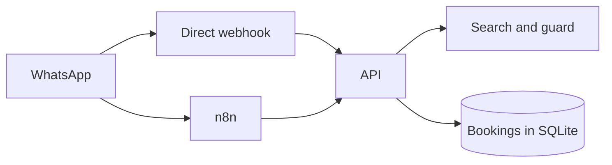

# grounded-faq-api

[](https://github.com/Dheightsan/grounded-faq-api/actions/workflows/ci.yml)
[](LICENSE)
[](https://www.python.org/)


The [WhatsApp agent](#whatsapp-agent) in the terminal, with `python -m app.cli`.

A small FastAPI service that answers questions only from a fixed fact file
(`data/store.json`, a fictional hardware store in Santiago). When the fact is not
there, it says `No tengo ese dato.` instead of guessing.

## Results

- 117 tests pass with `pytest -q`, none of them uses the network.
- Held-out set (50 questions, 31 answerable), no model: 15 correct, 16 refused by mistake, 2 wrong.
- Same set with a model: 30 correct, 1 refused by mistake, 0 wrong.
- All 19 questions outside the data were rejected with the model, 17 without it.
- Model: `nvidia/nemotron-3-ultra-550b-a55b:free` on OpenRouter, one run on 23 Nov 2026. More in [Evaluation](#evaluation).

## Quick start

Python 3.12 or newer.

```bash
python -m venv .venv
source .venv/bin/activate        # Windows: .venv\Scripts\activate
pip install -e ".[dev]"
uvicorn app.main:app --reload
```

It runs without any key. With no model configured, the answer is the text of the
best matching fact.

## Docker

```bash
docker compose up
```

This starts the API on `localhost:8000` and n8n on `localhost:5678`, with the two
workflows from `n8n/` imported and published. To send a message the way
WhatsApp would, post it to the n8n webhook.

```bash
curl -s localhost:5678/webhook/whatsapp -H "Content-Type: application/json" \
  -d '{"entry":[{"changes":[{"value":{"messages":[{"from":"56911111111","id":"m1","type":"text","text":{"body":"hola"}}]}}]}]}'
```

The reply comes back in the response and nothing is sent to WhatsApp. The n8n
editor asks for a local owner account the first time you open it. The workflows
are imported again on every start, so changes made in the editor are lost.

The keys default to `change-me`. Set `AGENT_API_KEY` and `WHATSAPP_VERIFY_TOKEN`
before putting it anywhere public.

## Example

```bash
curl -s localhost:8000/ask \
  -H "Content-Type: application/json" \
  -d '{"question": "Cuanto cuesta el taladro?"}'
```

```json
{"answer":"El taladro percutor de 650 W cuesta $42.990.","grounded":true,"sources":["precio-taladro"]}
```

A question the data cannot answer:

```json
{"answer":"No tengo ese dato.","grounded":false,"sources":[]}
```

Other endpoints: `GET /health`, `GET /facts?topic=precios`.

## How it works

1. `app/retrieval.py` ranks facts with BM25 (lowercase, accents removed, short
   Spanish stopword list, one-letter typos mapped to known words). Each fact can
   carry `keywords`, other words a customer may use for it. The best fact also
   has to cover at least half of the question's weight, so "cuanto cuesta un
   masaje" does not get the price of a haircut. If not, and there is no model,
   the service returns the fallback.
2. If `MODEL_API_KEY` and `MODEL_BASE_URL` are set, `app/chat_client.py` sends the
   top 3 facts, numbered, to a chat-completions endpoint (`MODEL_NAME` picks the
   model). The system message allows only those facts or the exact fallback, and
   asks for the number of the fact used, like `[2]`. The request times out after
   20 seconds, and any failure drops back to the extractive answer.
3. When the coverage rule refuses, the model gets the top 5 facts that share a
   word with the question and decides if one of them answers it. A question that
   shares no word with any fact never reaches the model.
4. `app/guard.py` checks the model answer. Every number (including `12.990` and
   `$12.990`), time, URL and email must appear in the facts the model cited. If
   not, the answer is replaced by the fallback and `grounded` is `false`. An
   answer that cites no fact is dropped too, and `sources` lists only the cited
   facts.

## Tests

```bash
ruff check .
pytest -q
```

117 tests. They use no network: the model is a fake injected through FastAPI
dependencies, and the HTTP client runs on `httpx.MockTransport`.

## Evaluation

```bash
python -m app.evaluate                                     # add --markdown for a table
python -m app.evaluate --questions data/eval_heldout.json
python -m app.evaluate --with-model                        # needs the MODEL_ variables
```

A question counts as correct when the expected fact is the source of the answer
(with a model, one of the facts it cited), and as rejected when the answer is
`No tengo ese dato.` A wrong answer is another fact, or any fact for a question
that should be rejected. `missed` means the facts had the answer and the service
refused. So `answerable` is correct plus missed plus the wrong answers to
answerable questions, and the rest of `wrong` is out-of-scope questions that got
an answer.

### Without a model

`data/eval.json` has 58 questions (42 barber shop, 16 hardware store), 20 of
them about things the facts do not have. I wrote them before the first run. That
run gave 30 correct and 23 wrong: almost any question sharing one word with a
fact got that fact. The coverage rule and the keywords came from looking at
those failures, so this set is no longer a fair test.

| set | answerable | correct | missed | out_of_scope | rejected | wrong |
|---|---|---|---|---|---|---|
| barberia | 28 | 22 | 6 | 14 | 13 | 1 |
| ferreteria | 10 | 8 | 1 | 6 | 4 | 3 |
| total | 38 | 30 | 7 | 20 | 17 | 4 |

Of the 4 wrong, 1 is an answerable hardware store question that got another
fact, and 3 are out-of-scope questions that got an answer.

`data/eval_heldout.json` has 50 more questions, written from the fact texts
only, without the code, the keywords or the first set. It was committed before
it was run, and nothing was tuned on it.

| set | answerable | correct | missed | out_of_scope | rejected | wrong |
|---|---|---|---|---|---|---|
| barberia | 19 | 7 | 12 | 11 | 11 | 0 |
| ferreteria | 12 | 8 | 4 | 8 | 6 | 2 |
| total | 31 | 15 | 16 | 19 | 17 | 2 |

On that set the code before the change got 24 correct and 16 wrong. Now it is 15
correct and 2 wrong, and missed went from 2 to 16. Most of the misses are long
chatty questions like "me pasas la direccion porfa, voy a ir con un amigo".

Both wrong answers here are out-of-scope questions.

### With a model

Run on 23 Nov 2026 with `nvidia/nemotron-3-ultra-550b-a55b:free` through
OpenRouter, temperature 0, once per set.

```bash
export MODEL_API_KEY=...   # an OpenRouter key
export MODEL_BASE_URL=https://openrouter.ai/api/v1
export MODEL_NAME=nvidia/nemotron-3-ultra-550b-a55b:free
python -m app.evaluate --with-model --questions data/eval_heldout.json
```

First set, `data/eval.json`:

| set | answerable | correct | missed | out_of_scope | rejected | wrong |
|---|---|---|---|---|---|---|
| barberia | 28 | 26 | 2 | 14 | 14 | 0 |
| ferreteria | 10 | 10 | 0 | 6 | 6 | 0 |
| total | 38 | 36 | 2 | 20 | 20 | 0 |

Held-out set, `data/eval_heldout.json`:

| set | answerable | correct | missed | out_of_scope | rejected | wrong |
|---|---|---|---|---|---|---|
| barberia | 19 | 19 | 0 | 11 | 11 | 0 |
| ferreteria | 12 | 11 | 1 | 8 | 8 | 0 |
| total | 31 | 30 | 1 | 19 | 19 | 0 |

On the held-out set the model was called 44 times and no call failed. 15 of the
30 correct answers came from questions the coverage rule had refused. The model
answered `No tengo ese dato.` 14 times, and the guard blocked nothing in either
run. The one miss is "mandan cosas a Valparaiso o solo en Santiago?", which the
model refused.

Before step 3 existed, the same model on the first set got 31 correct, 7 missed
and 0 wrong. Step 3 and the system message were written against the first set
only. The held-out set was run with a model once, after that.

What these numbers do not show: it is one run of one model on small sets, and
free models change. "Correct" means the model cited the expected fact and the
guard passed the answer. I read the 15 rescued answers on the held-out set and
they say what the fact says, but nothing checks the wording automatically.

The same command runs 8 conversation scripts against the agent, and all 8 pass.
The floors for the runs without a model are pinned in `tests/test_evaluate.py`.

## WhatsApp agent



The same retrieval also runs a WhatsApp agent for a made-up barber shop
(`data/barberia/`). It books appointments, keeps a small customer list and
answers questions from the shop's facts, with the same `No tengo ese dato.` rule.

The customer books by picking a service, a day and a free time from numbered
lists. Free times come from the opening hours, the service length and the
bookings already taken. The overlap check and the insert run in one write
transaction, so two customers cannot get the same time. At most 2 active
bookings per phone, and a confirmation left for 30 minutes expires.

The name is saved only after the customer says yes. `BORRAR MIS DATOS` deletes
the name, the bookings and the conversation. `4` or "hablar con una persona"
hands the chat to the shop. The bot says "Te atiende una persona" once and stays
quiet until `MENU` or 12 hours later. Anything else goes to the FAQ.

The webhook does Meta's verification handshake and checks
`X-Hub-Signature-256` (it answers 503 until `WHATSAPP_APP_SECRET` is set).
Retried deliveries are answered once, and message ids are kept for 7 days.

Try it in the terminal, no keys or WhatsApp account needed:

```bash
python -m app.cli
```

Or through the API:

```bash
export AGENT_API_KEY=change-me
uvicorn app.main:app
curl -s localhost:8000/agent/message \
  -H "X-API-Key: change-me" -H "Content-Type: application/json" \
  -d '{"from": "56911111111", "text": "hola"}'
```

| Endpoint | Auth | Use |
|---|---|---|
| `POST /agent/message` | `X-API-Key` | one message in, one reply out. Optional `id` makes retries safe (n8n or any other channel) |
| `GET /agent/bookings?date=YYYY-MM-DD` | `X-API-Key` | bookings of one day, for reminders |
| `GET /whatsapp/webhook` | verify token | Meta's handshake |
| `POST /whatsapp/webhook` | app secret | messages from WhatsApp Cloud API |

Settings: `AGENT_API_KEY`, `AGENT_DB_PATH` (default `agent.db`), `AGENT_DATA_DIR`
(default `data/barberia`), and for WhatsApp `WHATSAPP_VERIFY_TOKEN`,
`WHATSAPP_APP_SECRET`, `WHATSAPP_TOKEN` and `WHATSAPP_PHONE_NUMBER_ID`. Without
the token the agent still answers, it just does not send anything.

### With n8n

`n8n/whatsapp_agent.json` receives the WhatsApp webhook, calls `/agent/message`
with the API key (an n8n "Header Auth" credential named `Agent API key`, header
`X-API-Key`) and sends the reply. Meta's GET handshake is checked against the
API, so the verify token is kept in one place. `n8n/reminders.json` reads
tomorrow's bookings every day at 18:00 and sends a reminder template.

n8n passes the WhatsApp message id as `id`, so Meta's retries are answered once.
When the reply has `handoff: true`, the disabled `Notify the shop` node can
message the shop. In this mode n8n ignores audio, images and stickers and sends
no reply. The direct webhook answers them with a short notice.

The nodes that send to WhatsApp ship disabled. To go live, add a `WhatsApp
token` credential (`Authorization: Bearer <token>`), put the phone number id in
their URL and enable them. In this mode n8n does not check the webhook
signature. The direct mode above does.

## Limitations

- Search is BM25 on words, with no embeddings. Without a model, about half of the
  answerable questions in the held-out set are refused, mostly long ones with
  extra words or verbs the facts and keywords do not have.
- A variant of a real product ("taladro percutor de 800 W") still gets the
  price of the one the store has.
- With a model the refusals mostly go away, but then every question that shares
  a word with a fact costs a model call, and the answer depends on that model
  following the system message. The guard only checks numbers, times, URLs and
  emails, so a wrong sentence without any of those would pass.
- The eval with a model is one run on 23 Nov 2026 with a free model. I have not
  repeated it or tried other models.
- One SQLite file and one process.

## How I built it

I built it with Claude Code. What I checked most by hand was the booking, so two
people can never get the same slot. The tests for that are in
`tests/test_agent.py`. The other one was the `No tengo ese dato.` rule, and the
eval above shows where it still misses.

## License

MIT
