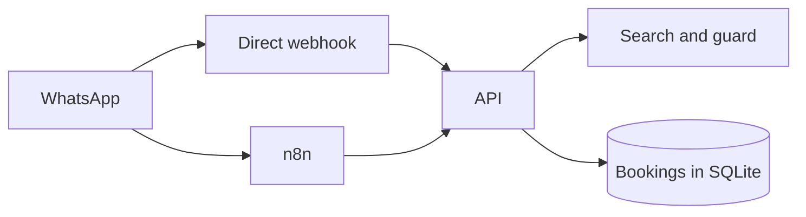

# grounded-faq-api

[](https://github.com/Dheightsan/grounded-faq-api/actions/workflows/ci.yml)
[](LICENSE)
[](https://www.python.org/)

A small FastAPI service that answers questions only from a fixed fact file
(`data/store.json`, a fictional hardware store in Santiago). When the fact is not
there, it says `No tengo ese dato.` instead of guessing.

## Quick start

Python 3.12 or newer.

```bash
python -m venv .venv
source .venv/bin/activate        # Windows: .venv\Scripts\activate
pip install -e ".[dev]"
uvicorn app.main:app --reload
```

It runs without any key. With no model configured, the answer is the text of the
best matching fact.

## Example

```bash
curl -s localhost:8000/ask \
  -H "Content-Type: application/json" \
  -d '{"question": "Cuanto cuesta el taladro?"}'
```

```json
{"answer":"El taladro percutor de 650 W cuesta $42.990.","grounded":true,"sources":["precio-taladro"]}
```

A question the data cannot answer:

```json
{"answer":"No tengo ese dato.","grounded":false,"sources":[]}
```

Other endpoints: `GET /health`, `GET /facts?topic=precios`.

## How it works

1. `app/retrieval.py` ranks facts with BM25 (lowercase, accents removed, short
   Spanish stopword list, one-letter typos mapped to known words). Each fact can
   carry `keywords`, other words a customer may use for it. The best fact also
   has to cover at least half of the question's weight, so "cuanto cuesta un
   masaje" does not get the price of a haircut. If not, the service returns the
   fallback without calling a model.
2. If `MODEL_API_KEY` and `MODEL_BASE_URL` are set, `app/chat_client.py` sends the
   top facts to a chat-completions endpoint (`MODEL_NAME` picks the model) with a
   system message that allows only those facts or the exact fallback. The request
   times out after 20 seconds, and any failure drops back to the extractive answer.
3. `app/guard.py` checks the model answer. Every number (including `12.990` and
   `$12.990`), time, URL and email must appear in the retrieved facts. If not, the
   answer is replaced by the fallback and `grounded` is `false`.

## Tests

```bash
ruff check .
pytest -q
```

The tests use no network: the model is a fake injected through FastAPI
dependencies, and the HTTP client runs on `httpx.MockTransport`.

## Evaluation

```bash
python -m app.evaluate                                     # add --markdown for a table
python -m app.evaluate --questions data/eval_heldout.json
```

Both runs use no model. A question counts as correct when the expected fact is
the source of the answer, and as rejected when the answer is `No tengo ese
dato.` A wrong answer is another fact, or any fact for a question that should be
rejected. `missed` means the facts had the answer and the service refused.

`data/eval.json` has 58 questions (42 barber shop, 16 hardware store), 20 of
them about things the facts do not have. I wrote them before the first run. That
run gave 30 correct and 23 wrong: almost any question sharing one word with a
fact got that fact. The coverage rule and the keywords came from looking at
those failures, so this set is no longer a fair test.

| set | answerable | correct | missed | out_of_scope | rejected | wrong |
|---|---|---|---|---|---|---|
| barberia | 28 | 22 | 6 | 14 | 13 | 1 |
| ferreteria | 10 | 8 | 1 | 6 | 4 | 3 |
| total | 38 | 30 | 7 | 20 | 17 | 4 |

`data/eval_heldout.json` has 50 more questions, written from the fact texts
only, without the code, the keywords or the first set. It was committed before
it was run, and nothing was tuned on it.

| set | answerable | correct | missed | out_of_scope | rejected | wrong |
|---|---|---|---|---|---|---|
| barberia | 19 | 7 | 12 | 11 | 11 | 0 |
| ferreteria | 12 | 8 | 4 | 8 | 6 | 2 |
| total | 31 | 15 | 16 | 19 | 17 | 2 |

On that set the code before the change got 24 correct and 16 wrong. Now it is 15
correct and 2 wrong. I'd rather it says it doesn't know than give a wrong price.
Long chatty questions ("me pasas la direccion porfa, voy a
ir con un amigo") are the ones it misses most.

The same command runs 8 conversation scripts against the agent (booking, two
customers for one slot, cancelling, asking for a person, erasing data, an expired
confirmation, the booking limit, a question outside the data). All 8 pass. The
floor for the first set is pinned in `tests/test_evaluate.py`.

## WhatsApp agent



The same retrieval also runs a WhatsApp agent for a made-up barber shop
(`data/barberia/`). It books appointments, keeps a small customer list and
answers questions from the shop's facts, with the same `No tengo ese dato.` rule.

The customer books by picking a service, a day and a free time from numbered
lists. Free times come from the opening hours, the service length and the
bookings already taken. The overlap check and the insert run in one write
transaction, so two customers cannot get the same time. At most 2 active
bookings per phone, and a confirmation left for 30 minutes expires.

The name is saved only after the customer says yes. `BORRAR MIS DATOS` deletes
the name, the bookings and the conversation. `4` or "hablar con una persona"
hands the chat to the shop. The bot says "Te atiende una persona" once and stays
quiet until `MENU` or 12 hours later. Anything else goes to the FAQ.

The webhook does Meta's verification handshake and checks
`X-Hub-Signature-256` (it answers 503 until `WHATSAPP_APP_SECRET` is set).
Retried deliveries are answered once, and message ids are kept for 7 days.

Try it in the terminal, no keys or WhatsApp account needed:

```bash
python -m app.cli
```

Or through the API:

```bash
export AGENT_API_KEY=change-me
uvicorn app.main:app
curl -s localhost:8000/agent/message \
  -H "X-API-Key: change-me" -H "Content-Type: application/json" \
  -d '{"from": "56911111111", "text": "hola"}'
```

| Endpoint | Auth | Use |
|---|---|---|
| `POST /agent/message` | `X-API-Key` | one message in, one reply out. Optional `id` makes retries safe (n8n or any other channel) |
| `GET /agent/bookings?date=YYYY-MM-DD` | `X-API-Key` | bookings of one day, for reminders |
| `GET /whatsapp/webhook` | verify token | Meta's handshake |
| `POST /whatsapp/webhook` | app secret | messages from WhatsApp Cloud API |

Settings: `AGENT_API_KEY`, `AGENT_DB_PATH` (default `agent.db`), `AGENT_DATA_DIR`
(default `data/barberia`), and for WhatsApp `WHATSAPP_VERIFY_TOKEN`,
`WHATSAPP_APP_SECRET`, `WHATSAPP_TOKEN` and `WHATSAPP_PHONE_NUMBER_ID`. Without
the token the agent still answers, it just does not send anything.

### With n8n

`n8n/whatsapp_agent.json` receives the WhatsApp webhook, calls `/agent/message`
with the API key (an n8n "Header Auth" credential named `Agent API key`, header
`X-API-Key`) and sends the reply. Meta's GET handshake is checked against the
API, so the verify token is kept in one place. `n8n/reminders.json` reads
tomorrow's bookings every day at 18:00 and sends a reminder template.

n8n passes the WhatsApp message id as `id`, so Meta's retries are answered once.
When the reply has `handoff: true`, the disabled `Notify the shop` node can
message the shop. In this mode n8n ignores audio, images and stickers and sends
no reply. The direct webhook answers them with a short notice.

The nodes that send to WhatsApp ship disabled. To go live, add a `WhatsApp
token` credential (`Authorization: Bearer <token>`), put the phone number id in
their URL and enable them. In this mode n8n does not check the webhook
signature. The direct mode above does.

## Limitations

- Search is BM25 on words, with no embeddings. Without a model, about half of the
  answerable questions in the held-out set are refused, mostly long ones with
  extra words or verbs the facts and keywords do not have.
- A variant of a real product ("taladro percutor de 800 W") still gets the
  price of the one the store has.
- The coverage check runs before the model, so model mode refuses the same
  questions, and I haven't run the eval with a model yet.
- One SQLite file and one process.

## How I built it

I built it with Claude Code. What I checked most was that two people can never
get the same slot and that the bot says it doesn't know instead of making up an
answer. Both are covered by the tests.

## License

MIT
